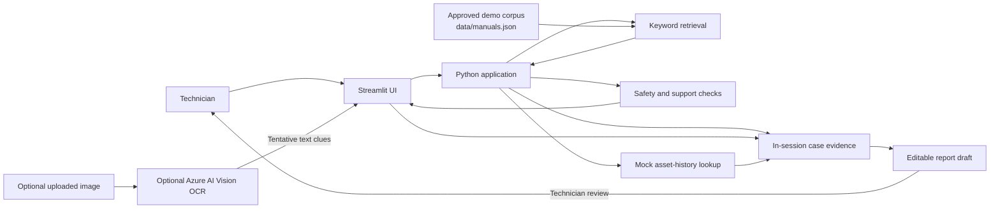

# Field Technician Copilot

A Python portfolio demo of an evidence-linked support assistant for commercial HVAC field technicians. It follows a simulated rooftop-unit service visit from initial fault report through documentation-backed checks to a technician-reviewed service-report draft.

> **Demonstration only.** The app uses simulated service data and a small sample corpus. It is not a diagnostic authority, a substitute for manufacturer instructions or site safety procedures, or a control system for real equipment.

## Why this project?

Typical demos stop after answering a question. Field Technician Copilot keeps the evidence and work history connected across a service visit:

- A technician reports a fault and can attach an equipment or fault-display image.
- The app retrieves relevant passages from its bundled approved demo documents.
- It presents checks with citations, or explicitly says when the corpus cannot support an answer.
- Technician-confirmed observations and check outcomes become part of the case record.
- The same references and observations carry into an editable service report.

The goal is to demonstrate how an AI-enabled support experience can make evidence, uncertainty, and human review visible—not to automate field repairs.

## Demo scenario

The bundled example follows a simulated rooftop HVAC unit, `HVAC-RTU-104`, with a recurring `F07` startup fault. The manuals and service records are demonstration content, not real manufacturer guidance.

## Features

- **Python application:** Streamlit user interface and Python application logic.
- **Case intake:** Record an equipment ID and reported symptom; optionally attach a PNG or JPEG.
- **Optional image OCR:** Use Azure AI Vision to extract tentative visible text from an uploaded image. OCR output is not treated as confirmed equipment information until the technician verifies it.
- **Cited troubleshooting:** Retrieve passages and ordered checks from a small local JSON corpus. Each check links to its source.
- **Honest limitations:** Unsupported questions produce an explicit no-answer response; safety-sensitive requests trigger a refusal/escalation message.
- **Case evidence:** Record observations and check outcomes, with references preserved in the case.
- **Constrained mock tool:** Look up synthetic asset history for known demo assets. No real CMMS or customer system is contacted.
- **Service-report draft:** Review, edit, and download a Markdown report. It is never automatically submitted.
- **Automated tests:** Exercise retrieval, citations, unsupported queries, safety handling, report provenance, mock data isolation, and OCR parsing.

## Architecture



### Request flow

1. Start a case and describe the symptom.
2. Optionally upload a photo. If Azure credentials are configured, request OCR and verify its tentative text clues.
3. Ask a troubleshooting question. The local retriever ranks corpus entries by keyword overlap and displays matching source passages and checks.
4. Record what was observed or what happened during a documented check.
5. Review and edit the report draft, then download it if desired.

## Requirements

- Python **3.10 or newer**
- `pip`
- Optional: an Azure AI Vision resource for image OCR

The basic application runs locally without cloud credentials. Only the OCR feature requires Azure AI Vision.

## Run locally

### Windows PowerShell

```powershell
python -m venv .venv
.\.venv\Scripts\Activate.ps1
python -m pip install --upgrade pip
python -m pip install -r requirements.txt
python -m streamlit run app.py
```

### macOS / Linux

```bash
python3 -m venv .venv
source .venv/bin/activate
python -m pip install --upgrade pip
python -m pip install -r requirements.txt
python -m streamlit run app.py
```

Streamlit prints a local URL (typically `http://localhost:8501`). The app starts with a simulated `HVAC-RTU-104` case prefilled in the sidebar.

## Optional Azure AI Vision OCR

OCR uses the Azure AI Vision Image Analysis REST API with the `read` feature. Set the endpoint and key in the environment before starting Streamlit.

### Windows PowerShell

```powershell
$env:AZURE_VISION_ENDPOINT = "https://<your-resource-name>.cognitiveservices.azure.com"
$env:AZURE_VISION_KEY = "<your-azure-ai-vision-key>"
python -m streamlit run app.py
```

### macOS / Linux

```bash
export AZURE_VISION_ENDPOINT="https://<your-resource-name>.cognitiveservices.azure.com"
export AZURE_VISION_KEY="<your-azure-ai-vision-key>"
python -m streamlit run app.py
```

Use the endpoint shown for your Azure AI Vision resource. Do not put credentials in source files, screenshots, sample data, or commits. If OCR is not configured, the app explains that it is unavailable and the technician can enter or confirm details manually. OCR/network/service errors are surfaced rather than converted into successful-looking results.

## Try the demo

1. In the sidebar, leave `HVAC-RTU-104` and the sample `F07` symptom or enter another simulated case.
2. Select **Start / update case**.
3. Ask: “What checks are documented for recurring startup fault F07?” Expand **Evidence passages** to inspect the citations.
4. Record a documented check and a simulated outcome under **Record the visit**.
5. Optionally use **Look up mock asset history** to show the synthetic maintenance entries.
6. Review and edit the service report. Marking it reviewed is only a local demo state; no ticket or external report is submitted.
7. Try an unsupported question, such as a weather forecast, to see the no-guess response.
8. Try asking how to bypass a safety interlock to see the safe escalation behavior.
9. If OCR is configured, upload a synthetic equipment-label image and verify the extracted clues yourself.

## Tests

The test suite uses Python's standard `unittest` module; no separate test framework is required.

```powershell
python -m unittest discover -s tests -v
```

Or, on macOS/Linux:

```bash
python -m unittest discover -s tests -v
```

To check Python syntax:

```bash
python -m py_compile app.py fieldtech_assistant.py tests/test_fieldtech_assistant.py
```

## Project structure

```text
.
├── app.py                         # Streamlit UI and in-session workflow
├── fieldtech_assistant.py         # Corpus loading, retrieval, safeguards, OCR, report
├── data/
│   └── manuals.json               # Synthetic, cited troubleshooting corpus
├── tests/
│   └── test_fieldtech_assistant.py
├── requirements.txt               # Runtime dependency constraints
├── SRS.md                         # Requirements specification and Mermaid diagrams
└── README.md
```

## How retrieval and answer grounding work

The initial retriever is intentionally small and inspectable: it tokenizes the technician's question and ranks the bundled documents by keyword overlap. Matching passages supply the citations and checks shown in the interface. If no document shares a meaningful token with the question, the app returns an unsupported response rather than inventing a troubleshooting step.

This is a deterministic demonstration of a source-grounded workflow, **not** a production retrieval-augmented generation (RAG) system and not an LLM-generated diagnostic. It does not use embeddings, a vector database, or a general-purpose chat model. The Azure service is used only for optional OCR.

## Safety, privacy, and data boundaries

- Use synthetic case information and approved documents only. The bundled assets, manuals, and service history are fictional demo data.
- Do not upload real customer records or sensitive equipment images to this demo.
- OCR is an external Azure request when enabled; images sent for OCR are processed by the configured Azure resource.
- Treat OCR output as tentative; verify the equipment model and fault code.
- The assistant is not authorized to control equipment or submit service requests.
- Follow applicable manufacturer documentation, licensing requirements, training, and workplace safety procedures. When the approved demo corpus does not support a safe next step, stop and escalate.

## AI-103 portfolio context

This project can be used to discuss topics such as AI solution design, multimodal input, information retrieval, responsible AI, evaluation, and application integration. It is not an official Microsoft sample and does not claim comprehensive alignment with the AI-103 exam. Check the current official exam skills outline before representing any feature as a specific exam objective.

## Current limitations and possible next steps

The current build is deliberately scoped for a small, repeatable portfolio demo:

- Cases live in Streamlit session state and are not persisted across sessions.
- Retrieval is keyword-based and the document corpus is small.
- OCR is optional; there is no visual object identification or fault diagnosis.
- Asset history is hard-coded mock data; there is no real work-order integration.
- There is no user authentication, authorization, or production data protection.

Possible future improvements include persistent case storage, a configurable document-ingestion pipeline, hybrid or semantic search, a richer retrieval evaluation set, and an optional grounded language model that preserves the current citation and safety requirements.

## Requirements specification

See [SRS.md](SRS.md) for the detailed scope, functional and non-functional requirements, acceptance criteria, and Mermaid diagrams.

## License

No license has been selected for this project yet. Add a `LICENSE` file before publishing if you want to grant others permission to reuse or modify the code. Check the terms for any separately added documentation, images, or other sample content as well.
