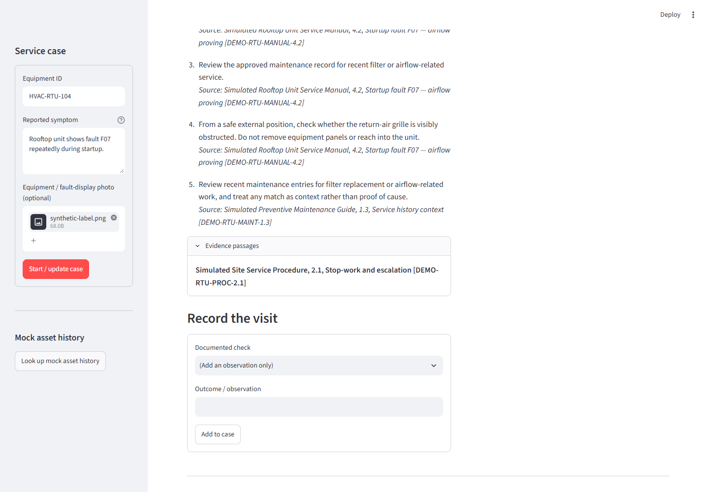
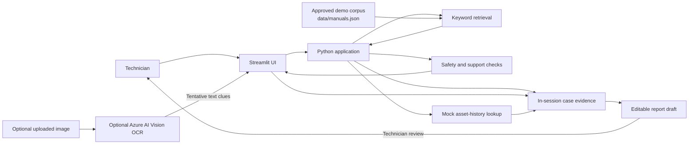

# Field Technician Copilot

[](https://github.com/silent-vector-26/support-assistant/actions/workflows/deploy-azure.yml)
[](https://www.python.org/)
[](https://streamlit.io/)
[](https://learn.microsoft.com/azure/container-apps/overview)
[](infra/)
[](LICENSE)

A Python portfolio demo of an evidence-linked support assistant for commercial HVAC field technicians. It follows a simulated rooftop-unit service visit from initial fault report through documentation-backed checks to a technician-reviewed service-report draft.

> **Project specification:** See the [Software Requirements Specification](docs/SRS.md) for the project's scope, requirements, acceptance criteria, safety boundaries, and Mermaid diagrams. It describes what this demo is designed to do—and what it deliberately does not do.

> **System design:** The [Software Design Description (SDD)](docs/SDD.md) explains how the requirements are implemented, with Mermaid diagrams covering architecture, the data model, case lifecycle, interactions, Azure deployment, and CI/CD. See the [cost-optimization guide](docs/COST_OPTIMIZATION.md) for spending controls and trade-offs.

> **Demonstration only.** The app uses simulated service data and a small sample corpus. It is not a diagnostic authority, a substitute for manufacturer instructions or site safety procedures, or a control system for real equipment.

> **See it in action:** Follow the [demo walkthrough](docs/DEMO.md) for a credential-free tour with screenshots.



**Explore:** [Demo walkthrough](docs/DEMO.md) · [Requirements](docs/SRS.md) · [System design](docs/SDD.md) · [Cost optimization](docs/COST_OPTIMIZATION.md) · [Local setup](#run-locally) · [Azure deployment](#deploy-to-azure-container-apps) · [Contributing](docs/CONTRIBUTING.md)

## Why this project?

Typical demos stop after answering a question. Field Technician Copilot keeps the evidence and work history connected across a service visit:

- A technician reports a fault and can attach an equipment or fault-display image.
- The app retrieves relevant passages from its bundled approved demo documents.
- It presents checks with citations, or explicitly says when the corpus cannot support an answer.
- Technician-confirmed observations and check outcomes become part of the case record.
- The same references and observations carry into an editable service report.

The goal is to demonstrate how an AI-enabled support experience can make evidence, uncertainty, and human review visible—not to automate field repairs.

## Demo scenario

The bundled example follows a simulated rooftop HVAC unit, `HVAC-RTU-104`, with a recurring `F07` startup fault. The manuals and service records are demonstration content, not real manufacturer guidance.

## Features

- **Python application:** Streamlit user interface and Python application logic.
- **Case intake:** Record an equipment ID and reported symptom; optionally attach a PNG or JPEG.
- **Optional image OCR:** Use Azure AI Vision to extract tentative visible text from an uploaded image. OCR output is not treated as confirmed equipment information until the technician verifies it.
- **Cited troubleshooting:** Retrieve passages and ordered checks from a small local JSON corpus. Each check links to its source.
- **Honest limitations:** Unsupported questions produce an explicit no-answer response; safety-sensitive requests trigger a refusal/escalation message.
- **Case evidence:** Record observations and check outcomes, with references preserved in the case.
- **Constrained mock tool:** Look up synthetic asset history for known demo assets. No real CMMS or customer system is contacted.
- **Service-report draft:** Review, edit, and download a Markdown report. New evidence automatically refreshes unedited reports; manual edits are preserved and must be explicitly reconciled before review or download. It is never automatically submitted.
- **Automated tests:** Exercise retrieval, citations, unsupported queries, safety handling, report provenance, mock data isolation, and OCR parsing.

## Architecture



### Request flow

1. Start a case and describe the symptom.
2. Optionally upload a photo. If Azure credentials are configured, request OCR and verify its tentative text clues.
3. Ask a troubleshooting question. The local retriever ranks corpus entries by keyword overlap and displays matching source passages and checks.
4. Record what was observed or what happened during a documented check.
5. Review and edit the report draft, then download it if desired.

## Requirements

- Python **3.10 or newer**
- `pip`
- Optional: an Azure AI Vision resource for image OCR

The basic application runs locally without cloud credentials. Only the OCR feature requires Azure AI Vision.

## Project guidance

- [Contributing](docs/CONTRIBUTING.md)
- [Security policy](docs/SECURITY.md)
- [Support](docs/SUPPORT.md)
- [Community standards](docs/CODE_OF_CONDUCT.md)
- [Citation metadata](CITATION.cff)
- [Testing and browser diagnostics](docs/TESTING.md)
- [Demo walkthrough](docs/DEMO.md)

Repository standards include the [MIT license](LICENSE), [editor settings](.editorconfig), [line-ending rules](.gitattributes), and [Git ignore rules](.gitignore). Documentation lives in `docs/`, except this README and the license.

## Deploy to Azure Container Apps

The repository includes Bicep infrastructure in `infra/` and a GitHub Actions workflow at `.github/workflows/deploy-azure.yml`. Pull requests targeting `main` run unit tests, Python syntax checks, Bicep compilation, a container build, and a parallel browser acceptance suite without Azure credentials. Relevant pushes to `main`, including PR merges, automatically run the same checks and queue deployment at the `azure-production` GitHub Environment approval gate only after both jobs pass. Manual runs remain available. Documentation-only pushes do not deploy. Deployments are serialized without cancelling an active deployment.

The resources are an Azure Container Apps environment, one public Container App, a Basic Azure Container Registry, and a Log Analytics workspace. The Container App uses a system-assigned identity, HTTPS ingress, 0–1 replicas, and the Streamlit port `8501`. On first deployment, Bicep uses a public placeholder image so the registry and identity exist. Subsequent runs preserve the deployed image during infrastructure provisioning. The workflow then pushes a commit-tagged app image and deploys it. The fixed ACR baseline was estimated at approximately **$5.10 USD/month**; this is a historical planning estimate, not a current quote. Container Apps and Log Analytics usage beyond their free grants, data transfer, and taxes may add cost.

> **Demo-only exposure:** ingress is public and the app has no sign-in. Use fictional data only; do not expose real customer, technician, or service records.

### Configure the GitHub deployment gate

Before the workflow can deploy, configure the repository and Azure identity:

1. In **Settings → Environments**, create `azure-production`, add the required reviewers, and restrict deployment branches to `main`. Environment protection is configured in GitHub, not in workflow YAML. Confirm your GitHub plan and repository visibility support required reviewers; do not run deployment until the protection rule is active.
2. Create or select an Azure service principal for GitHub Actions and add a federated identity credential with issuer `https://token.actions.githubusercontent.com` and audience `api://AzureADTokenExchange`. Match the subject to the repository's actual OIDC subject format. This repository uses the ID-qualified subject `repo:silent-vector-26@302260228/support-assistant@1434526386:environment:azure-production`, not the legacy name-only format.
3. Give that identity only the permissions needed to deploy the listed resources in the planned subscription and resource group. Subscription-scope Bicep needs permission to create/update the resource group and subscription deployment record; the resource-group deployment needs resource write permissions and permission to assign the ACR roles. Avoid granting blanket `Owner` access. Have an Azure administrator scope these permissions to this workload and, where supported, restrict role assignment permissions to the `AcrPull` and `AcrPush` roles used by the template.
4. In the `azure-production` environment, add these **variables**:

   | Variable | Value |
   |---|---|
   | `AZURE_CLIENT_ID` | Service principal application/client ID |
   | `AZURE_TENANT_ID` | Entra tenant ID |
   | `AZURE_SUBSCRIPTION_ID` | Subscription ID containing the deployment |
   | `AZURE_DEPLOYER_OBJECT_ID` | Service principal object ID (not its client ID) |
   | `AZURE_VISION_ENDPOINT` | Optional Azure AI Vision endpoint |

   Add `AZURE_VISION_KEY` as an **environment secret** only when enabling OCR. The workflow passes it as a secure Bicep parameter and the Container App stores it as a secret; it is never committed to the repository.
5. Merge a PR that changes application, tests, container, infrastructure, or workflow files into `main`, or run **Test and deploy to Azure** manually from **Actions**. Validation must pass before GitHub requests environment approval. Approving that job permits provisioning and deployment. Direct pushes with relevant changes also trigger deployment; use branch protection requiring PRs and the **Test application and validate Bicep** check if changes must only arrive through reviewed merges.

For example, the service principal object ID can be looked up by an Azure administrator with `az ad sp show --id <client-id> --query id -o tsv`. The workflow uses OIDC; no Azure client secret is stored in GitHub. The first deployment creates the resource group and resources described by `infra/main.bicep`. No Azure resources are created by adding these repository files.

Optional OCR works in Azure only when both Vision settings above are provided. Without them, image text extraction remains unavailable and technicians can enter or verify details manually.

## Run locally

### Windows PowerShell

```powershell
python -m venv .venv
.\.venv\Scripts\Activate.ps1
python -m pip install --upgrade pip
python -m pip install -r requirements.txt
python -m streamlit run app.py
```

### macOS / Linux

```bash
python3 -m venv .venv
source .venv/bin/activate
python -m pip install --upgrade pip
python -m pip install -r requirements.txt
python -m streamlit run app.py
```

Streamlit prints a local URL (typically `http://localhost:8501`). The app starts with a simulated `HVAC-RTU-104` case prefilled in the sidebar.

## Optional Azure AI Vision OCR

OCR uses the Azure AI Vision Image Analysis REST API with the `read` feature. Set the endpoint and key in the environment before starting Streamlit.

### Windows PowerShell

```powershell
$env:AZURE_VISION_ENDPOINT = "https://<your-resource-name>.cognitiveservices.azure.com"
$env:AZURE_VISION_KEY = "<your-azure-ai-vision-key>"
python -m streamlit run app.py
```

### macOS / Linux

```bash
export AZURE_VISION_ENDPOINT="https://<your-resource-name>.cognitiveservices.azure.com"
export AZURE_VISION_KEY="<your-azure-ai-vision-key>"
python -m streamlit run app.py
```

Use the endpoint shown for your Azure AI Vision resource. Do not put credentials in source files, screenshots, sample data, or commits. If OCR is not configured, the app explains that it is unavailable and the technician can enter or confirm details manually. OCR/network/service errors are surfaced rather than converted into successful-looking results.

## Try the demo

1. In the sidebar, leave `HVAC-RTU-104` and the sample `F07` symptom or enter another simulated case.
2. Select **Start / update case**.
3. Ask: “What checks are documented for recurring startup fault F07?” Expand **Evidence passages** to inspect the citations.
4. Record a documented check and a simulated outcome under **Record the visit**.
5. Optionally use **Look up mock asset history** to show the synthetic maintenance entries.
6. Review and edit the service report. If case evidence changes after editing, compare the latest generated report with your edits, then explicitly confirm reconciliation or replace your edits with the latest evidence. Review and download are blocked until reconciliation. Marking it reviewed is only a local demo state; no ticket or external report is submitted.
7. Try an unsupported question, such as a weather forecast, to see the no-guess response.
8. Try asking how to bypass a safety interlock to see the safe escalation behavior.
9. If OCR is configured, upload a synthetic equipment-label image and verify the extracted clues yourself.

## Tests

The test suite uses Python's standard `unittest` module; no separate test framework is required.
It includes core unit tests and Streamlit AppTest regressions for report refresh, preserved edits, reconciliation, review invalidation, OCR confirmation, and case replacement. A separate Playwright/Chromium acceptance suite exercises the complete browser journey, downloaded report, unsupported/unsafe questions, and unavailable/failed OCR without Azure credentials. See [Testing](docs/TESTING.md) for setup and diagnostics. Both suites gate deployment in CI.

```powershell
python -m unittest discover -s tests -v
```

Or, on macOS/Linux:

```bash
python -m unittest discover -s tests -v
```

To check Python syntax:

```bash
python -m py_compile app.py fieldtech_assistant.py tests/test_fieldtech_assistant.py
```

## Project structure

```text
.
├── app.py                         # Streamlit UI and in-session workflow
├── fieldtech_assistant.py         # Corpus loading, retrieval, safeguards, OCR, report
├── data/
│   └── manuals.json               # Synthetic, cited troubleshooting corpus
├── tests/
│   ├── test_fieldtech_assistant.py
│   ├── test_report_workflow.py    # Streamlit report synchronization regressions
│   └── browser/test_acceptance.py # Separate real-browser suite
├── infra/
│   ├── main.bicep                 # Subscription-scope entry point and resource group
│   ├── main.parameters.json       # Non-secret deployment parameters
│   └── modules/                   # ACR, Container Apps platform, and app
├── .github/
│   └── workflows/
│       └── deploy-azure.yml       # Test, protected approval, and deployment
├── docs/
│   ├── CODE_OF_CONDUCT.md
│   ├── CONTRIBUTING.md
│   ├── SECURITY.md
│   ├── SRS.md                     # Requirements specification and Mermaid diagrams
│   ├── SDD.md                     # Software design and deployment behavior
│   ├── COST_OPTIMIZATION.md       # Spending controls and optimization backlog
│   ├── TESTING.md                 # Browser acceptance setup and diagnostics
│   ├── DEMO.md                    # Walkthrough, limitations, and screenshots
│   ├── media/                     # Synthetic-data screenshots
│   └── SUPPORT.md
├── scripts/
│   └── capture_screenshots.py     # Regenerates docs/media screenshots
├── .dockerignore                 # Container build context exclusions
├── .editorconfig                 # Shared editor settings
├── .gitattributes                # Repository line-ending rules
├── .gitignore                    # Local artifacts and secret exclusions
├── Dockerfile                     # Non-root Streamlit container on port 8501
├── requirements.txt               # Runtime dependency constraints
├── requirements-dev.txt           # Browser testing dependencies, not runtime
├── CITATION.cff                   # Software citation metadata
├── LICENSE                        # MIT License
└── README.md
```

## How retrieval and answer grounding work

The initial retriever is intentionally small and inspectable: it tokenizes the technician's question and ranks the bundled documents by keyword overlap. Matching passages supply the citations and checks shown in the interface. If no document shares a meaningful token with the question, the app returns an unsupported response rather than inventing a troubleshooting step.

This is a deterministic demonstration of a source-grounded workflow, **not** a production retrieval-augmented generation (RAG) system and not an LLM-generated diagnostic. It does not use embeddings, a vector database, or a general-purpose chat model. The Azure service is used only for optional OCR.

## Safety, privacy, and data boundaries

- Use synthetic case information and approved documents only. The bundled assets, manuals, and service history are fictional demo data.
- Do not upload real customer records or sensitive equipment images to this demo.
- OCR is an external Azure request when enabled; images sent for OCR are processed by the configured Azure resource.
- Treat OCR output as tentative; verify the equipment model and fault code.
- The assistant is not authorized to control equipment or submit service requests.
- Follow applicable manufacturer documentation, licensing requirements, training, and workplace safety procedures. When the approved demo corpus does not support a safe next step, stop and escalate.

## Portfolio context

This project demonstrates AI solution design, multimodal input, information retrieval, responsible AI, evaluation, and application integration. It is an independent portfolio project, not an official Microsoft sample.

## Current limitations and possible next steps

The current build is deliberately scoped for a small, repeatable portfolio demo:

- Cases live in Streamlit session state and are not persisted across sessions.
- Retrieval is keyword-based and the document corpus is small.
- OCR is optional; there is no visual object identification or fault diagnosis.
- Asset history is hard-coded mock data; there is no real work-order integration.
- There is no user authentication, authorization, or production data protection.

Possible future improvements include persistent case storage, a configurable document-ingestion pipeline, hybrid or semantic search, a richer retrieval evaluation set, and an optional grounded language model that preserves the current citation and safety requirements.

## License

This project is licensed under the [MIT License](LICENSE). The license applies to project materials owned by the repository author; separately sourced documents, images, and dependencies may have their own terms.
