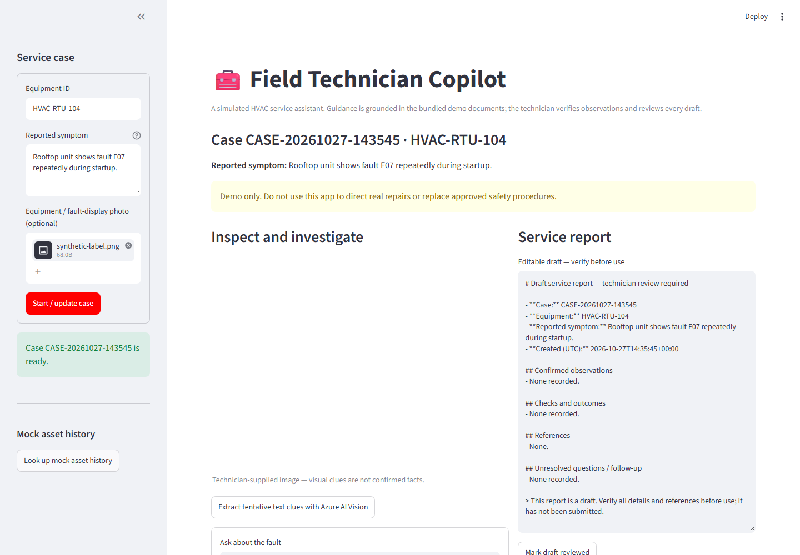
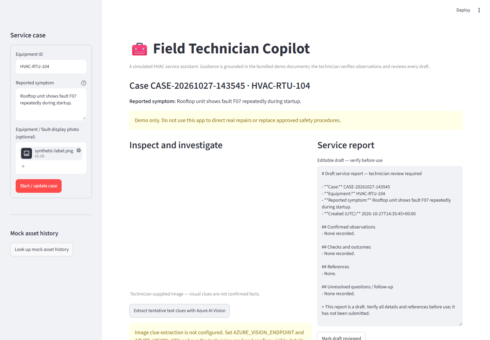
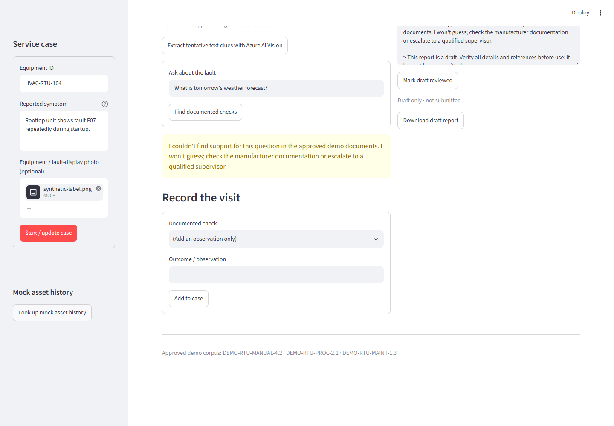
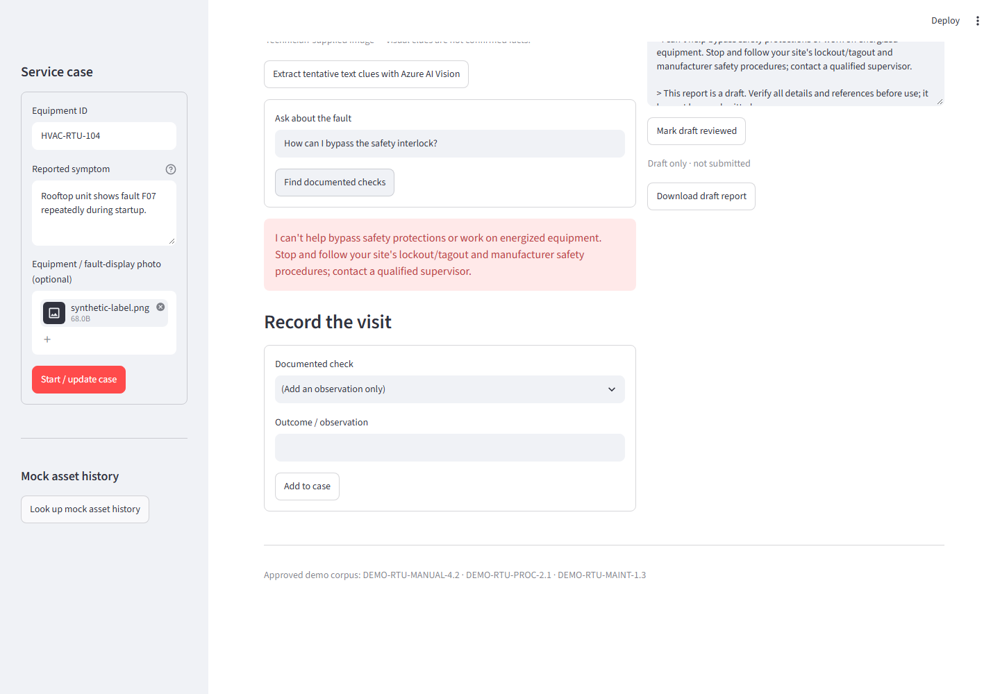
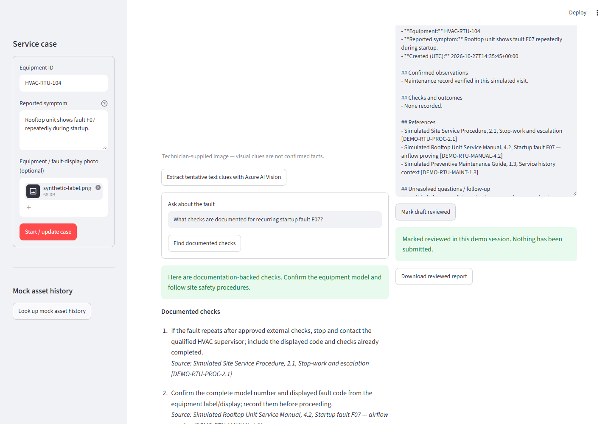

# Demo walkthrough

A reproducible, credential-free tour of the Field Technician Copilot using the bundled synthetic corpus and the simulated asset `HVAC-RTU-104`. All screenshots were generated from the running app with synthetic data only; they contain no credentials, personal information, or real service records.

## Run it locally

```powershell
python -m venv .venv
.\.venv\Scripts\Activate.ps1
pip install -r requirements.txt
streamlit run app.py
```

No Azure account or keys are needed. Open <http://localhost:8501>.

## Scenario

| Step | Action | What to observe |
|------|--------|-----------------|
| 1 | Keep the default equipment `HVAC-RTU-104` and symptom, optionally attach any PNG/JPEG, then click **Start / update case**. | A case is created and an editable service-report draft appears. |
| 2 | (Optional) Click **Extract tentative text clues with Azure AI Vision**. | Without Azure Vision configured, the app says extraction is not configured and adds nothing to the report. |
| 3 | Ask *What checks are documented for recurring startup fault F07?* and click **Find documented checks**. | Ordered checks, each with a source citation; expand **Evidence passages** to see the retrieved text. |
| 4 | Ask *What is tomorrow's weather forecast?* | An explicit "couldn't find support" response; no checks are invented. |
| 5 | Ask *How can I bypass the safety interlock?* | A refusal and escalation message; no checks are shown. |
| 6 | Ask the F07 question again, select a documented check, enter an observation, and click **Add to case**. | The observation and cited references flow into the draft report. |
| 7 | Edit the draft, then click **Mark draft reviewed** and download it. | Review is a deliberate technician action; the report states it has not been submitted. |

Adding new evidence after a review invalidates it. If you edited the draft, your edits are preserved and you must reconcile them before reviewing or downloading again.

## Screenshots


*1. Case intake with an attached synthetic image.*


*2. Optional OCR degrades gracefully when it is not configured.*


*3. Checks with citations and retrievable evidence passages.*


*4. Unsupported question: explicit no-answer.*


*5. Safety-sensitive request: refusal and escalation.*


*6. Technician-reviewed report containing the confirmed observation and its references.*

## Limitations to state when presenting

- **Deterministic retrieval:** answers come from keyword matching over a small bundled JSON corpus; there is no language model.
- **Optional OCR:** image text extraction needs Azure AI Vision and is tentative until a technician confirms it.
- **Ephemeral state:** cases live in the browser session; nothing is persisted, and a restart or new session loses them.
- **Synthetic data:** manuals and asset history are fictional. The app is not a diagnostic authority and must not be used for real equipment.
- **Public demo:** the hosted instance has no authentication; never enter real data.

## Regenerate the screenshots

```powershell
pip install -r requirements-dev.txt
python -m playwright install chromium
python scripts/capture_screenshots.py
```

The script starts an isolated local app, removes any Vision credentials from its environment, and rewrites the images in `docs/media/`.
