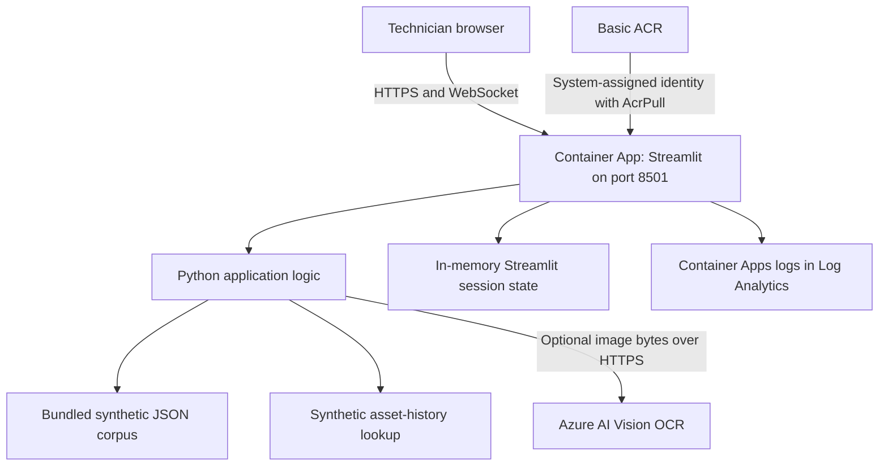
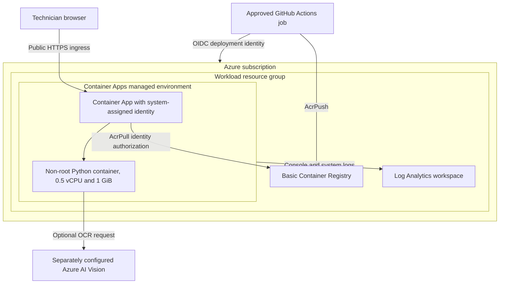
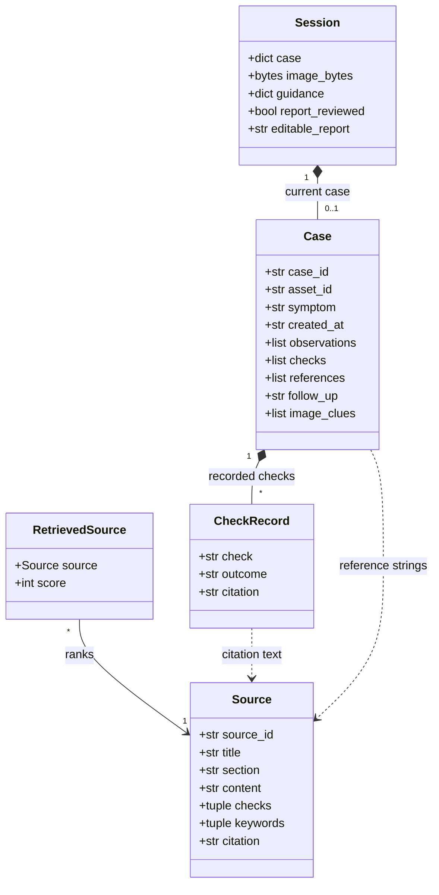
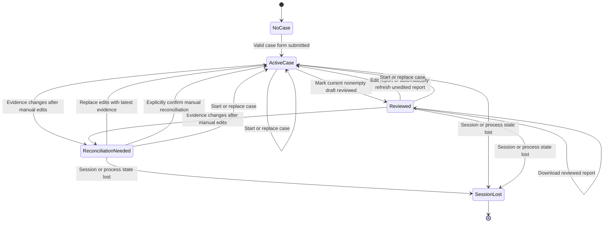
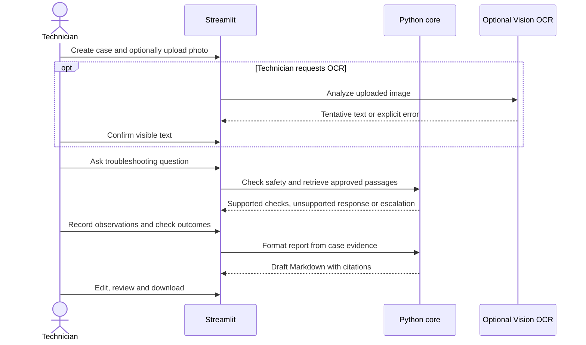
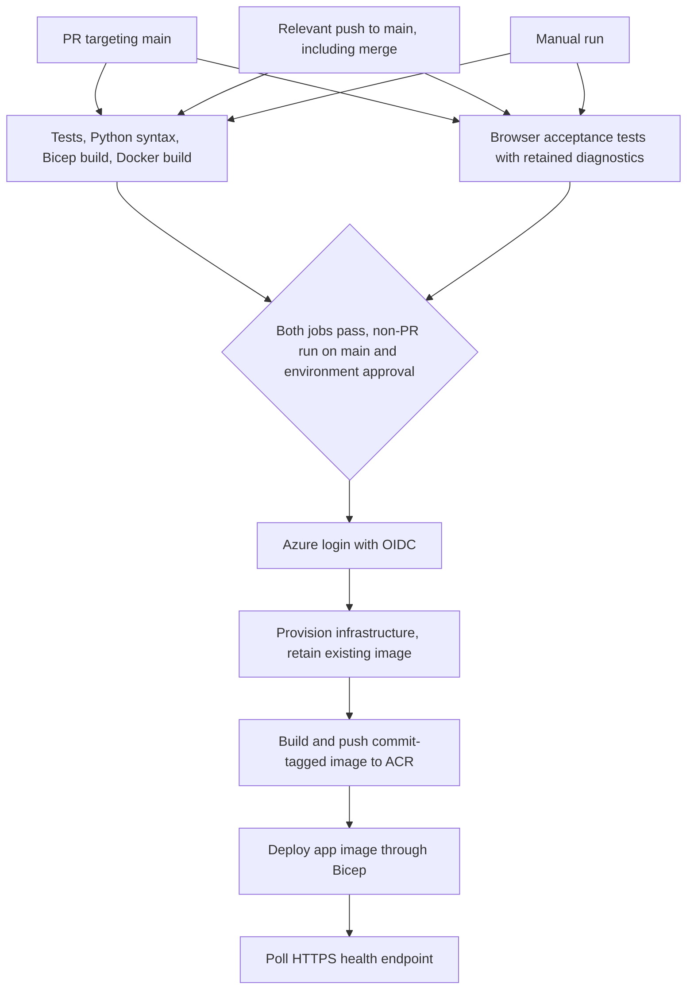

# Software Design Description

## 1. Purpose and scope

This document describes the implemented Field Technician Copilot and its delivery pipeline. The [SRS](SRS.md) defines requirements; this document explains how the Python demo addresses them. It is not a production diagnostic system. Retrieval is deterministic, not LLM-based RAG, and OCR is the only optional AI service call.

## 2. Components and deployment

| Component | Responsibility |
|---|---|
| `app.py` | Forms, session state, OCR confirmation, guidance display, check recording, report editing and download |
| `fieldtech_assistant.py` | Corpus loading, tokenization, ranking, safety patterns, mock assets, OCR REST client, report formatting |
| `data/manuals.json` | Approved synthetic passages, stable source IDs, checks and keywords |
| `tests/test_fieldtech_assistant.py` | Deterministic unit tests for core supported and failure paths |
| `tests/browser/test_acceptance.py` | Isolated Chromium journeys, report downloads and synthetic OCR failure checks |
| `Dockerfile` | Python 3.12 slim runtime, installed dependencies, non-root Streamlit process |
| `infra/main.bicep` | Subscription-scope resource group and modular infrastructure deployment |
| `infra/modules/` | Basic ACR, Log Analytics, Container Apps environment, app and ACR role assignments |

No database, message broker, vector index, model deployment or external work-order system is provisioned.

### Azure resource topology

The managed environment hosts a single app with zero to one replica. The registry and workspace remain provisioned when the app has zero replicas. Vision is external to this Bicep deployment. This diagram shows resource ownership and logical dependencies, not private networking: no VNet or private endpoint is configured.

## 3. Data and state

`Source` is an immutable dataclass with `source_id`, `title`, `section`, `content`, `checks` and `keywords`. `RetrievedSource` pairs it with an integer overlap score.

A case dictionary contains `case_id`, `asset_id`, `symptom`, `created_at`, `observations`, `checks`, `references`, `follow_up` and `image_clues`. Check records carry check text, outcome and citation. Uploaded image bytes, the latest guidance, editable report text and review state reside in Streamlit session state.

Case IDs use UTC timestamps with second precision and are demo identifiers, not globally unique production keys. There is no durable case store or audit trail. Restart, revision replacement, scale-to-zero or connection/session loss can discard work. Downloading the report is the only explicit export. One maximum replica avoids cross-replica session routing but does not make sessions durable.

### Logical data model

`Case`, `CheckRecord` and `Session` are logical shapes, not additional Python classes or database tables. Only `Source` and `RetrievedSource` are dataclasses. Editable report text uses a session widget key reset on case replacement, even if a timestamp-based case ID is reused. Two generated-report snapshots track the latest evidence and the evidence last reconciled with the editor.

### Case and report lifecycle

These are UI states, not a stored lifecycle enum. Downloading does not close the case, and there is no persisted resolved status. Every change to generated report content invalidates review, including confirmed OCR observations, guidance references and follow-up limitations. Manual editor changes also invalidate review. Unchanged evidence on a rerun does not invalidate review.

An unedited report refreshes automatically. A manually edited report is preserved when evidence changes, with the latest generated report shown alongside it. Review and download remain blocked until the technician explicitly replaces their edits or confirms that they manually reconciled them with the latest evidence. Reconciliation does not itself mark the report reviewed. The confirmation is a human attestation, not automatic semantic verification of report correctness.

## 4. Guidance and evidence flow

Safety regexes run before retrieval. Unsupported unsafe requests return escalation without evidence or checks. Otherwise, ASCII alphanumeric tokenization removes stop words and short tokens. Retrieval counts unique query-token overlap, sorts descending by score then source ID, and returns at most three positive-score passages. Checks are deduplicated and retain source citations. Zero matches produces an explicit unsupported result.

This is a transparent demonstration heuristic, not semantic relevance verification or a comprehensive safety classifier. OCR text is not automatically used to diagnose equipment. Confirmed clues become observations. References on the case reflect the latest guidance, while recorded check citations remain attached to those checks.

## 5. OCR and failure handling

`analyze_image` posts image bytes to the configured endpoint's `/computervision/imageanalysis:analyze` route with API version `2024-02-01`, feature `read`, and a key header. The default request timeout is 20 seconds. Missing configuration, empty input, HTTP/network failures and malformed responses surface as explicit limitations/errors. There is no automatic retry or OCR cache.

Corpus load failures stop the UI. Unknown mock assets produce a visible warning. Generated reports contain a draft disclaimer; marking reviewed is session-local and submits nothing externally. Download labels and filenames distinguish draft from reviewed state. Empty or unreconciled reports cannot be downloaded, and an empty report cannot be marked reviewed.

## 6. CI/CD and infrastructure lifecycle

PR jobs have read-only repository access and do not receive Azure environment credentials. Relevant `main` pushes include Python, data, tests, infrastructure, dependencies, Docker configuration and the deployment workflow. Documentation-only pushes do not deploy. Manual dispatch is supported, but deployment only runs on `main`.

Browser tests install development-only Playwright dependencies and Chromium, launch isolated loopback Streamlit processes, and verify interaction and downloaded content. OCR failure tests use absent configuration or a local synthetic service. Browser logs, screenshots and traces are retained for seven days in CI. Both the validation and browser jobs must pass before deployment. See [Testing](TESTING.md).

The `azure-production` environment supplies variables/secrets and required-reviewer protection. Environment rules and branch protection are GitHub settings, not enforced by YAML alone. Deployment concurrency serializes production jobs without cancelling an active job. GitHub may replace an older pending job with a newer pending job; this is latest-pending delivery, not a durable queue of every merge.

On first provisioning, the public placeholder image lets the system identity exist before private image pulls. On later provisioning, the workflow looks up and preserves the existing image instead of reverting the live application to the placeholder. Both provisioning passes receive the optional OCR configuration. A failed image build therefore does not intentionally replace the app with a placeholder, although infrastructure changes can still affect availability.

Images are tagged by commit SHA. A 90-second wait allows ACR role propagation before push. The final deployment sets the image through Bicep, then polls `/_stcore/health` up to 30 times, ten seconds apart. Any failed step fails the workflow. The health endpoint verifies Streamlit readiness, not OCR correctness or every user journey. No automatic rollback is implemented. A rerun of an older successful commit's workflow can redeploy that revision after approval, but also reapplies that commit's infrastructure and must be reviewed accordingly.

## 7. Identity, configuration and security boundaries

GitHub OIDC exchanges a short-lived token using the exact environment subject. This repository uses an ID-qualified subject, recorded in the [README](../README.md). There is no stored Azure client secret. The deployment identity creates subscription/resource-group deployments and assigns registry roles. The app identity has `AcrPull`; the deployer has `AcrPush` on the registry. ACR admin credentials are disabled.

Vision endpoint/key are optional and must be supplied together. The key is a GitHub environment secret, a secure Bicep parameter, and a Container App secret reference. A Vision resource is not provisioned by this repository.

Public HTTPS ingress has no user authentication or authorization. Regex checks, citations and technician confirmation are demo safeguards, not production access controls. Use only fictional data. Current subscription-wide deployment RBAC is broader than desirable; narrowing it requires a separately reviewed Azure access change.

## 8. Requirements traceability and trade-offs

| SRS requirement | Design realization |
|---|---|
| FR-1, FR-6 | Case creation and in-session observations/check evidence |
| FR-2 | Optional OCR and explicit technician confirmation |
| FR-3, FR-4 | Local corpus, deterministic retrieval, cited passages/checks |
| FR-5 | Pre-retrieval safety patterns and unsupported escalation |
| FR-7 | In-process synthetic asset lookup, no external side effects |
| FR-8 | Editable Markdown draft and download, no automatic submission |
| FR-9, NFR-6 | Core/AppTest regressions and real-browser acceptance tests in CI, not a comprehensive groundedness evaluation |
| NFR-2, NFR-3, NFR-4 | Citation fields, synthetic data boundary, visible dependency failures |
| Section 13 | Bicep, non-root container, OIDC, protected deployment and live health check |

Scale-to-zero and local retrieval minimize idle/model spend at the cost of cold starts, ephemeral sessions and limited relevance. These limitations are intentional for the portfolio demo. See [Cost optimization](COST_OPTIMIZATION.md) for operational controls and deferred changes.
