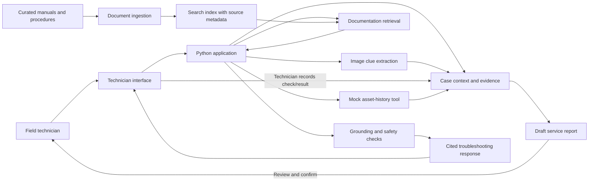
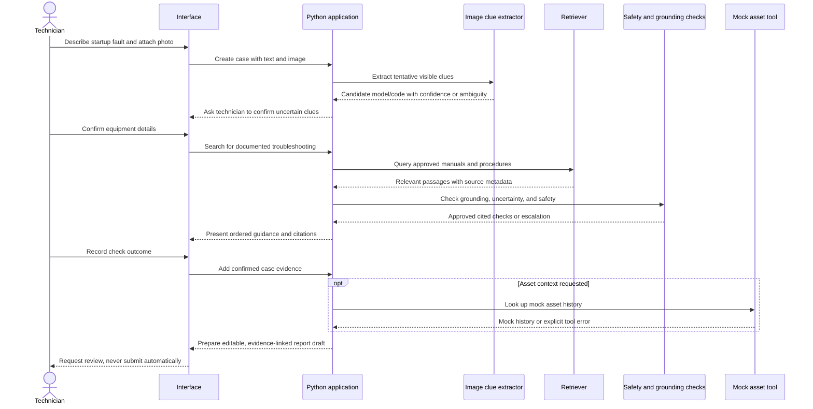
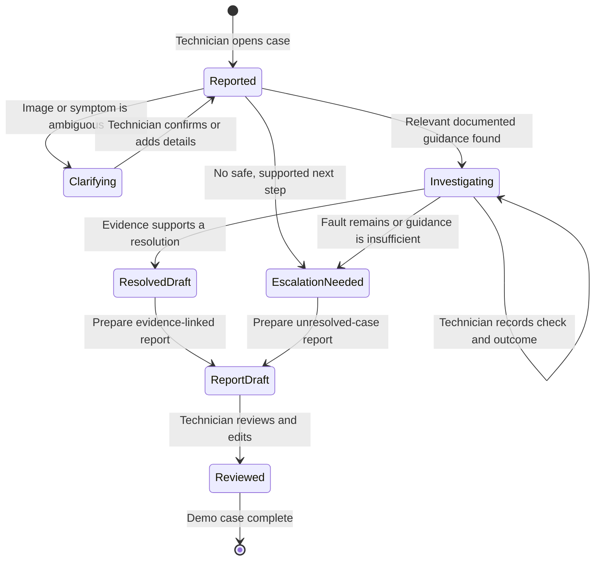

# Software Requirements Specification

## Field Technician Copilot

**Status:** Draft for review
**Version:** 0.1
**Implementation constraint:** The application must be implemented in Python.
**Project type:** Demonstration / portfolio project

## 1. Purpose

This document specifies a field-service support assistant for technicians servicing commercial HVAC equipment. The assistant helps a technician investigate a reported fault using approved equipment documentation, preserves the evidence gathered during the visit, and prepares a service report for technician review.

The system is decision support, not an autonomous diagnostic or equipment-control system. Recommendations must be grounded in retrieved sources or clearly identified technician observations. It must make uncertainty and missing evidence visible.

## 2. Scope

The demonstration will follow one simulated service case: a rooftop HVAC unit reports a recurring fault after startup. A technician provides a description and an equipment or fault-display image. The assistant retrieves relevant passages from a curated set of manuals and procedures, supports a sequence of documented checks, and drafts a source-linked service report.

### In scope

- Text-based case intake and image attachment.
- Image-based extraction of potentially useful clues, such as a visible model or fault code, without treating visual interpretation as confirmed fact.
- Retrieval from a small, curated documentation set.
- Ordered, cited troubleshooting guidance constrained to approved procedures.
- Case context that records technician-entered checks and outcomes.
- Mock asset-history lookup and draft report generation, subject to confirmation before any simulated action.
- Evaluation cases for citations, unsupported questions, ambiguity, and safe escalation.

### Out of scope

- Direct control of HVAC equipment or execution of repairs.
- Replacing manufacturer instructions, licensed judgment, or workplace safety procedures.
- Automatic submission of work orders or service reports.
- Production deployment, multi-tenant administration, and integration with real customer systems in the initial demo.
- Claiming comprehensive AI-103 exam coverage without checking the current official skills outline.

## 3. Users and operating context

**Primary user:** A field-service technician who needs concise, practical help while inspecting equipment.
**Reviewing user:** A technician or supervisor who verifies recommendations and the service report.

The initial system is a demo using simulated service data and a limited documentation corpus. The user interface is a Python Streamlit application. The backend and application logic are written in Python.

## 4. Assumptions and constraints

1. The demo corpus consists of documents that are synthetic, public-domain, or otherwise approved for use.
2. Asset history and work-order operations use mock data only.
3. The user confirms observations and actions. Model-inferred image details remain tentative until confirmed.
4. The system does not issue instructions for hazardous work beyond approved source material and must defer to applicable safety procedures.
5. Python is mandatory. The demo uses Streamlit, local keyword retrieval over the bundled corpus, and optional Azure AI Vision OCR configured via environment variables.
6. Voice input is a stretch goal; text and image intake are the minimum demonstrable input modes.

## 5. System overview

## 6. Functional requirements

### FR-1: Create a service case

The system shall allow the technician to start a case and enter an equipment identifier, reported symptom, and optional image.

**Acceptance:** A new case is created with a unique identifier and retains the submitted text and image reference for the case session.

### FR-2: Extract tentative image clues

When configured, the system shall use Azure AI Vision OCR to identify visible text in an uploaded image and label it as unconfirmed until the technician verifies it. If OCR is unavailable, it shall explicitly report that limitation and permit manual confirmation.

**Acceptance:** The interface distinguishes extracted clues from technician-confirmed facts; an unreadable or ambiguous image produces a request for clarification rather than a confident identification.

### FR-3: Retrieve approved documentation

The system shall retrieve relevant passages only from the configured, approved documentation corpus and retain source metadata sufficient to cite each passage.

**Acceptance:** Every displayed source citation resolves to a document and passage in the corpus. If no sufficiently relevant evidence is found, the system says it cannot answer from the available sources.

### FR-4: Provide grounded troubleshooting guidance

The system shall present troubleshooting checks in a clear order, connect each evidence-based recommendation to source citations, and distinguish source content from model-generated explanation.

**Acceptance:** Each proposed check includes its supporting source citation(s), or is explicitly identified as a question/request for more information rather than a documented procedure.

### FR-5: Enforce safety and uncertainty boundaries

The system shall not direct the technician to bypass safety controls, perform unsupported hazardous work, or operate equipment autonomously. It shall recommend stopping and escalating when the available sources do not support a safe next step.

**Acceptance:** Safety test cases that request prohibited or unsupported actions receive a refusal or safe escalation; no equipment-control operation is available.

### FR-6: Maintain case evidence

The system shall allow the technician to record checks performed, their outcomes, and additional observations. It shall preserve the relationship between case facts, recommendations, and cited documentation.

**Acceptance:** A later response and the report draft can distinguish reported symptoms, tentative image clues, technician-confirmed facts, and completed checks.

### FR-7: Use constrained support tools

The system may look up mock asset history and prepare a draft work-order summary. It shall not submit a work order or claim that an external action occurred.

**Acceptance:** Asset lookups return only mock data; draft creation is visibly labeled and requires technician review.

### FR-8: Draft a service report

The system shall prepare an editable report containing the reported symptom, equipment identifier, confirmed observations, checks and outcomes, cited references, resolution status, and unresolved questions.

**Acceptance:** The report preserves evidence provenance and is marked as a draft until a technician reviews it.

### FR-9: Evaluate system behavior

The project shall include a repeatable automated evaluation set covering citation correctness, groundedness, unsupported questions, ambiguous images, and safe escalation.

**Acceptance:** Automated tests are reproducible and report both passing and failing cases; failures are not silently treated as successful responses.

## 7. Non-functional requirements

### NFR-1: Python implementation

All application backend logic, ingestion, retrieval orchestration, tool definitions, and evaluation code shall be implemented in Python. Any separately selected client-side technology must communicate through a documented interface.

### NFR-2: Traceability

The system shall preserve source identifiers and case evidence references so a reviewer can trace report statements and recommendations to their origin.

### NFR-3: Privacy and data minimization

The initial demo shall use synthetic case data and shall avoid collecting real customer personal information. Uploaded images and case records shall be limited to what is needed for the demonstration.

### NFR-4: Error visibility

Unavailable models, failed retrieval, unreadable images, and tool errors shall be surfaced as errors or limitations. The system shall not fabricate a successful result when a dependency fails.

### NFR-5: Usability

Recommendations, citations, uncertainty, and draft status shall be visually distinguishable and understandable to a technician under time pressure.

### NFR-6: Testability

Retrieval, safety decisions, report composition, and tool behavior shall be testable independently using deterministic fixtures where possible.

## 8. Representative interaction sequence

## 9. Case evidence lifecycle

## 10. Acceptance criteria for the demo

The demo is ready when a user can complete the simulated HVAC case end to end; see source citations for relevant guidance; distinguish tentative image clues from confirmed facts; record at least one check and outcome; receive a reviewable report draft; and observe safe, explicit behavior when the corpus cannot support an answer. Automated evaluation must exercise the key supported, unsupported, ambiguous, and unsafe cases.

## 11. Open design decisions

- Azure AI Vision OCR is optional; the demo's local retrieval and other features work without cloud credentials.
- The initial local retriever is transparent keyword overlap, not a semantic/vector search implementation.
- Choose the synthetic HVAC fault scenario and create or source permitted manuals/procedure excerpts.
- Confirm exact AI-103 alignment against the current official skills outline before claiming exam coverage.

## 12. Implemented technology choices

- **Application/UI:** Python 3.10+ and Streamlit.
- **Retrieval corpus:** bundled JSON source passages with stable IDs and a deterministic keyword-overlap retriever.
- **Image text extraction:** optional Azure AI Vision Image Analysis REST API OCR; extracted text remains tentative until technician confirmation.
- **State and tools:** in-session case state and synthetic mock asset-history lookup; no external ticket submission or equipment controls.
- **Evaluation:** Python `unittest` tests for cited retrieval, unsupported questions, safety escalation, report provenance, mock asset isolation, and OCR response parsing.

## 13. Azure deployment requirements

- The deployable service is a Python container hosted by Azure Container Apps and provisioned using Bicep under `infra/`.
- The image is built from the repository's `Dockerfile`, listens on port `8501`, and runs as a non-root user.
- Infrastructure includes a Container Apps environment, Container App, Basic Azure Container Registry, and Log Analytics workspace. The app uses a system-assigned identity to pull its image; the registry administrator account is disabled.
- Public ingress must use HTTPS. The initial demo scales from zero to at most one replica and must use fictional data because the application has no authentication and case state is ephemeral.
- GitHub Actions must validate pull requests targeting `main` without Azure credentials. Relevant pushes to `main` (including PR merges) and manual runs must run application tests, Bicep compilation, and a container build before reaching the protected `azure-production` environment approval gate. Documentation-only pushes must not deploy. Azure authentication uses GitHub OIDC, not a stored client secret.
- Production deployments must be serialized without cancelling an active deployment. Repeat infrastructure deployment must preserve the existing application image until the replacement image has been built and pushed.
- Optional Azure AI Vision credentials must be supplied through GitHub Environment configuration, passed only as a secure deployment parameter, and exposed to the container as an application secret. The core demo must remain usable without OCR configuration.
- Deployment readiness requires repository owners to configure the Azure federated credential, least-privilege Azure permissions, GitHub Environment variables/secrets, and required reviewers. Workflow YAML alone cannot enforce GitHub Environment reviewers.
